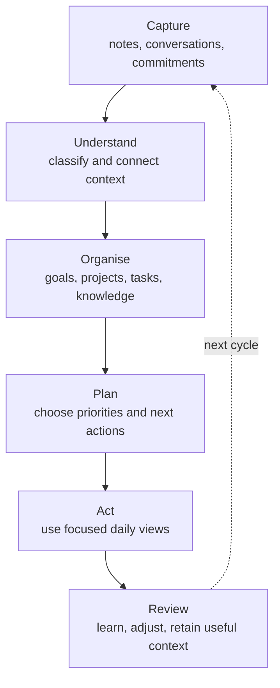
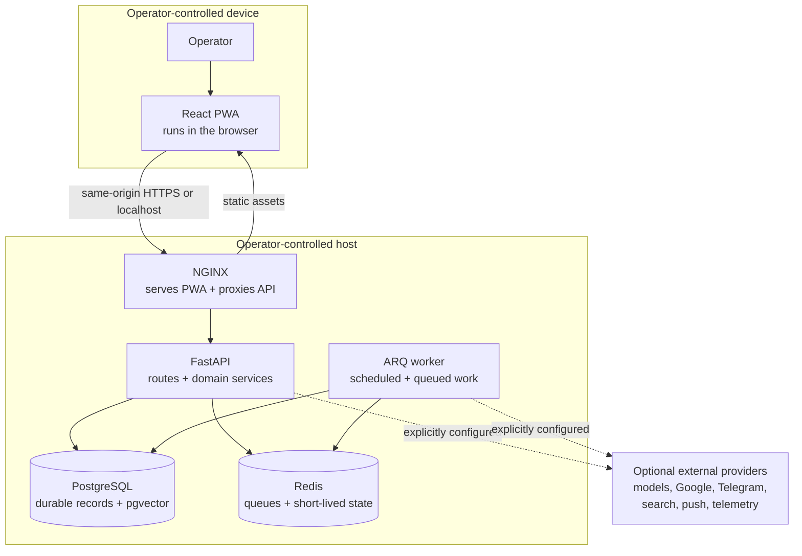

# Personal Execution OS

Personal Execution OS is a self-hosted workspace for keeping track of what you
have captured and deciding what to do next. Notes, commitments, projects,
goals, habits, reviews, and connected information all live in one installable
web app.

It is built for a single owner who wants to run the software and keep control
of the data. The app runs on your machine, listens on localhost by default, and
does not send application data to optional providers until you configure one.
Installing or building the software can still contact container registries and
package repositories.

> **Release status:** public preview. The local installation path, browser
> authentication, core data model, PWA, and automated test suite are working.
> The project has not had an independent security audit. Do not expose it
> directly to the public internet or import irreplaceable data without a tested
> backup.


_Synthetic sample data; no live account or personal records._

## Mobile PWA layout


_Synthetic sample data captured with `cd frontend && npm run capture:showcase`. This is the
installable web app, not a native iOS or Android app._

## What it does

- Captures conversations, notes, diary entries, decisions, and commitments
- Organises goals, projects, tasks, habits, reviews, and personal knowledge
- Searches and filters structured local records
- Plans and reviews work through focused daily and periodic workflows
- Runs scheduled work in a separate background worker
- Installs from the browser as a responsive PWA on desktop or mobile
- Adds model, messaging, read-only Google Workspace, web search, push, and
  telemetry integrations only when the operator enables them

The default install does not require a model API key. Model-backed features
show a clear unavailable state until a provider is configured.

This is not a phone operating system, a hosted account service, or a native iOS
or Android application. The mobile experience is the installable PWA.

See [the capability and maturity matrix](docs/CAPABILITIES.md) for a precise
split between the working local core, optional local services, external
providers, disabled-by-default operator systems, and unsupported code.

## The execution loop

The main workflow is a repeatable day-to-day loop:



Records, search, planning views, and reviews work without a model account.
When a model provider is configured, it can help classify, retrieve, or draft.
The same local identity, storage, privacy, and side-effect controls apply in
both cases.

## How it works

The browser talks to a same-origin NGINX edge, which serves the React PWA and
proxies API requests to FastAPI. The API applies authentication and request
controls before calling domain services. PostgreSQL is the durable source of
truth; Redis holds queues and short-lived coordination state. A separate
worker runs scheduled and queued work. Model and provider calls remain outside
the local trust boundary and are made only when their feature is configured.



Models cannot authorize actions. A model can classify, draft, or propose, but
application code validates and authorizes every supported operation. The
public runtime does not enable MCP tool execution, and the supported Google
connectors are read-only.

More detail:

- [Architecture](docs/ARCHITECTURE.md) explains the system, trust boundaries,
  runtime flows, data model, failure behavior, and major design trade-offs.
- [Developer guide](docs/DEVELOPER_GUIDE.md) traces the code from browser to
  database and shows where to add a page, endpoint, model, migration, worker,
  integration, or test.
- [Architecture decisions](docs/decisions/README.md) records the alternatives
  considered and the consequences of the choices made.
- [Documentation map](docs/README.md) suggests a reading path for operators,
  evaluators, security reviewers, and contributors.

## Quick start

For a reproducible installation, use the latest tagged release rather than an
arbitrary default-branch revision. After cloning or downloading it, open a
POSIX shell in the repository root. The Compose install does not need Python
or Node.js on the host. The start command is a shell script, so Windows users
need a POSIX environment such as WSL.

You also need a running Docker Engine with Docker Compose 2.24.0 or later.
Docker Desktop and Colima are both suitable.

```sh
./scripts/start.sh
```

The script creates private local configuration, generates required secrets
without printing them, builds the pinned images, applies database migrations,
and waits for the services to become healthy.

Open [http://localhost:8080/setup](http://localhost:8080/setup), create the
local owner password, and sign in. The password is hashed with Argon2id and
browser sessions use an HTTP-only cookie plus CSRF protection.

Then follow [the first ten minutes walkthrough](docs/FIRST_TEN_MINUTES.md) to
create a small fictional workspace with every optional provider still
disabled.

To stop the application without deleting its data:

```sh
docker compose stop
```

Read [the setup guide](docs/SETUP.md) before enabling integrations, exposing a
remote address, or upgrading. Follow the separate [backup and recovery
guide](docs/BACKUP_AND_RECOVERY.md) before storing irreplaceable data or
restoring an archive.

## Safe defaults

- The web port listens on `127.0.0.1`, not every network interface.
- The web proxy accepts only localhost or an explicitly configured public
  hostname and rejects arbitrary Host headers.
- PostgreSQL, Redis, the API, and the worker have no published host ports.
- The application uses an RLS-constrained database role; schema migrations and
  database bootstrap use separate non-runtime credentials.
- Separate Compose networks prevent the web proxy from reaching PostgreSQL or
  Redis directly.
- Browser authentication is initialized locally on first run.
- Credentialed provider integrations start disabled. Explicit URL retrieval is
  available only when the operator submits a URL.
- Local identity, secrets, logs, runtime data, screenshots, and generated
  reports are excluded from Git and container build contexts.
- The service worker caches versioned static assets, not API responses,
  authentication state, personal records, or page navigations.
- Runtime containers are non-root where supported and use restricted
  capabilities and read-only filesystems.
- API and worker readiness are health-checked before startup is reported as
  complete.
- The checked-in CI workflows have no deployment job and neither request nor
  use deployment credentials.

These defaults help avoid common mistakes. You still need to secure the host,
use TLS for remote access, protect credentials, test encrypted backups, and
review any third-party provider you enable.

## Technology

- FastAPI, SQLAlchemy, Alembic, and ARQ
- PostgreSQL 16 with `pgvector`
- Redis 7
- React 19, TypeScript, Vite, and a service worker
- Docker Compose with an unprivileged NGINX edge container

See [ARCHITECTURE.md](docs/ARCHITECTURE.md) for the component and trust-boundary
model.

## External services

Every application integration is optional. Personal data can leave the host
when a configured feature sends it to a model, messaging, search, email,
calendar, or telemetry provider. Revoking a provider token does not
automatically erase local copies or provider-retained data.

[INTEGRATIONS.md](docs/INTEGRATIONS.md) lists the data flow, default state,
provider policy links, and disable procedure for each supported integration.
[PRIVACY.md](docs/PRIVACY.md) covers local storage, browser data, exports, and
deletion boundaries.

## Development

Development requires Python 3.12, `uv`, and Node.js 22 LTS at 22.22 or newer,
or Node.js 24 and newer. [CONTRIBUTING.md](CONTRIBUTING.md) is the canonical
source for the complete verification suite; these are the common local checks.

```sh
uv sync --frozen --extra dev
uv run ruff check src tests scripts
uv run ruff format --check src tests scripts
uv run ty check
uv run pytest tests/unit tests/integration

cd frontend
npm ci
npm run format:check
npm run lint
npm test
npm run build
```

Before publishing a source snapshot:

```sh
python3 scripts/public_release_audit.py --root .
uv export --frozen --no-dev --no-emit-project \
  --format requirements-txt \
  --output-file /tmp/personal-execution-os-production-requirements.txt
uv run pip-audit --strict \
  --requirement /tmp/personal-execution-os-production-requirements.txt
uv run pre-commit run --all-files
cd frontend && npm run audit:high
```

CI also checks documentation links and diagrams, the generated OpenAPI
document, evaluation assets, dependency changes, secrets, and CodeQL results.

## Project documents

- [Documentation map and reading paths](docs/README.md)
- [Setup and operations](docs/SETUP.md)
- [Capabilities and maturity](docs/CAPABILITIES.md)
- [First ten minutes](docs/FIRST_TEN_MINUTES.md)
- [Product scope and non-goals](docs/PRODUCT_SCOPE.md)
- [Roadmap and known debt](docs/ROADMAP.md)
- [Architecture](docs/ARCHITECTURE.md)
- [Developer guide](docs/DEVELOPER_GUIDE.md)
- [Release procedure](docs/RELEASING.md)
- [API contract](docs/API.md)
- [Configuration reference](docs/CONFIGURATION.md)
- [Observability](docs/OBSERVABILITY.md)
- [Accessibility](docs/ACCESSIBILITY.md)
- [Architecture decisions](docs/decisions/README.md)
- [Privacy](docs/PRIVACY.md)
- [Integration data guide](docs/INTEGRATIONS.md)
- [Security policy and threat model](SECURITY.md)
- [Contributing](CONTRIBUTING.md)
- [Governance](GOVERNANCE.md)
- [Support](SUPPORT.md)
- [Code of Conduct](CODE_OF_CONDUCT.md)
- [Changelog](CHANGELOG.md)

## License

Licensed under the [Apache License 2.0](LICENSE). See [NOTICE](NOTICE) for
attribution information.
