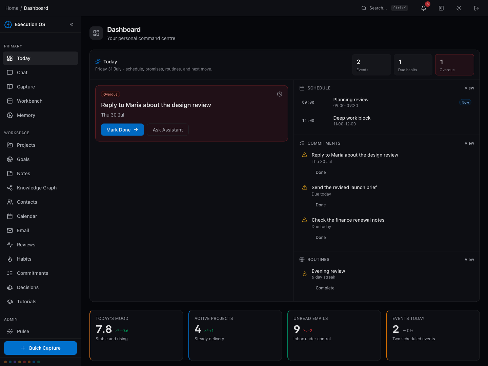
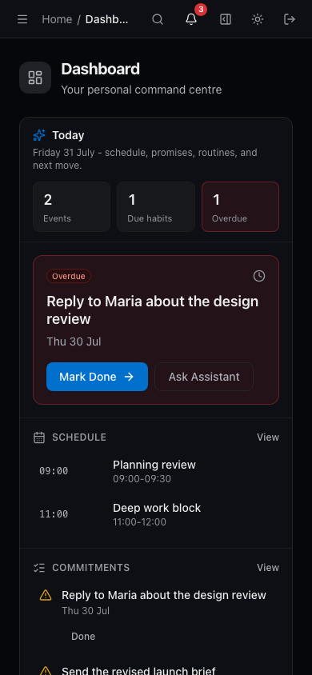

# Personal Execution OS

Personal Execution OS is a self-hosted workspace for turning daily input into
useful action. It brings notes, commitments, projects, goals, habits, reviews,
and connected information into one installable web app.

The project is built for one person who wants control of the data and the
software. It runs on your machine, binds to localhost by default, and keeps
external services off until you configure them.

> **Release status:** public preview. The local installation path, browser
> authentication, core data model, PWA, and automated test suite are working.
> The project has not had an independent security audit. Do not expose it
> directly to the public internet or import irreplaceable data without a tested
> backup.



_Synthetic sample data; no live account or personal records._

### Mobile PWA layout



_Synthetic sample data captured with `cd frontend && npm run capture:showcase`. This is the
installable web app, not a native iOS or Android app._

## What it does

- Captures conversations, notes, diary entries, decisions, and commitments
- Organises goals, projects, tasks, habits, reviews, and personal knowledge
- Searches structured records, with optional local vector search through
  Ollama and PostgreSQL `pgvector`
- Plans and reviews work through focused daily and periodic workflows
- Runs scheduled work in a separate background worker
- Installs from the browser as a responsive PWA on desktop or mobile
- Adds model, messaging, read-only Google Workspace, web search, push, and
  telemetry integrations only when the operator enables them

The default install does not require a model API key. Model-backed features
show a clear unavailable state until a provider is configured.

This is not a phone operating system, a hosted account service, or a native iOS
or Android application. The mobile experience is the installable PWA.

See [the capability and maturity matrix](docs/CAPABILITIES.md) for a precise
split between the working local core, optional local services, external
providers, disabled-by-default operator systems, and unsupported code.

## Quick start

After cloning or downloading this repository, open a POSIX shell in the
repository root. The supported Compose install does not require Python or
Node.js on the host, but the start command is a shell script rather than a
PowerShell script. Windows users need a POSIX environment such as WSL.

You also need a running Docker Engine with Docker Compose v2. Docker Desktop
and Colima are both suitable.

```sh
./scripts/start.sh
```

The script creates private local configuration, generates required secrets
without printing them, builds the pinned images, applies database migrations,
and waits for the services to become healthy.

Open [http://localhost:8080/setup](http://localhost:8080/setup), create the
local owner password, and sign in. The password is hashed with Argon2id and
browser sessions use an HTTP-only cookie plus CSRF protection.

Then follow [the first ten minutes walkthrough](docs/FIRST_TEN_MINUTES.md) to
create a small fictional workspace with every optional provider still
disabled.

To stop the application without deleting its data:

```sh
docker compose stop
```

Read [the setup guide](docs/SETUP.md) before enabling integrations, exposing a
remote address, upgrading, or restoring a backup.

## Safe defaults

- The web port listens on `127.0.0.1`, not every network interface.
- The web proxy accepts only localhost or an explicitly configured public
  hostname and rejects arbitrary Host headers.
- PostgreSQL, Redis, the API, and the worker have no published host ports.
- The application uses an RLS-constrained database role; schema migrations and
  database bootstrap use separate non-runtime credentials.
- Separate Compose networks prevent the web proxy from reaching PostgreSQL or
  Redis directly.
- Browser authentication is initialized locally on first run.
- The LLM provider and all external integrations start disabled.
- Local identity, secrets, logs, runtime data, screenshots, and generated
  reports are excluded from Git and container build contexts.
- The service worker caches versioned static assets, not API responses,
  authentication state, personal records, or page navigations.
- Runtime containers are non-root where supported and use restricted
  capabilities and read-only filesystems.
- API and worker readiness are health-checked before startup is reported as
  complete.
- CI has no deployment job and receives no production credentials.

These controls reduce common mistakes. They do not replace host security, TLS,
credential hygiene, encrypted backups, or review of third-party providers.

## Technology

- FastAPI, SQLAlchemy, Alembic, and ARQ
- PostgreSQL 16 with `pgvector`
- Redis 7
- React 19, TypeScript, Vite, and a service worker
- Docker Compose with an unprivileged NGINX edge container

See [ARCHITECTURE.md](docs/ARCHITECTURE.md) for the component and trust-boundary
model.

## External services

Every external service is optional. Personal data can leave the host when a
configured feature sends it to a model, messaging, search, email, calendar, or
telemetry provider. Revoking a provider token does not automatically erase
local copies or provider-retained data.

[INTEGRATIONS.md](docs/INTEGRATIONS.md) lists the data flow, default state,
provider policy links, and disable procedure for each supported integration.
[PRIVACY.md](docs/PRIVACY.md) covers local storage, browser data, exports, and
deletion boundaries.

## Development

Development requires Python 3.12, `uv`, and Node.js 22 LTS at 22.22 or newer,
or Node.js 24 and newer.

```sh
uv sync --frozen --extra dev
uv run ruff check src tests scripts
uv run ruff format --check src tests scripts
uv run ty check --exit-zero-on-warning
uv run pytest tests/unit tests/integration

cd frontend
npm ci
npm run format:check
npm run lint
npm test
npm run build
```

Before publishing a source snapshot:

```sh
python3 scripts/public_release_audit.py --root .
uv export --frozen --no-dev --no-emit-project \
  --format requirements-txt \
  --output-file /tmp/personal-execution-os-production-requirements.txt
uv run pip-audit --strict \
  --requirement /tmp/personal-execution-os-production-requirements.txt
uv run pre-commit run --all-files
cd frontend && npm run audit:high
```

CI also checks the generated OpenAPI document, evaluation assets, dependency
changes, secrets, and CodeQL results.

## Project documents

- [Setup and operations](docs/SETUP.md)
- [Capabilities and maturity](docs/CAPABILITIES.md)
- [First ten minutes](docs/FIRST_TEN_MINUTES.md)
- [Product scope and non-goals](docs/PRODUCT_SCOPE.md)
- [Roadmap and known debt](docs/ROADMAP.md)
- [Architecture](docs/ARCHITECTURE.md)
- [Privacy](docs/PRIVACY.md)
- [Integration data guide](docs/INTEGRATIONS.md)
- [Security policy and threat model](SECURITY.md)
- [Contributing](CONTRIBUTING.md)
- [Governance](GOVERNANCE.md)
- [Changelog](CHANGELOG.md)
- [Support](SUPPORT.md)

## License

Licensed under the [Apache License 2.0](LICENSE). See [NOTICE](NOTICE) for
attribution information.
