# Architecture

This guide explains how Personal Execution OS is put together, how a request
moves through it, where data crosses trust boundaries, and why the major
technical choices were made. It describes the supported public-preview
runtime. Code that exists without a supported operator path is labelled
separately in the [capability matrix](CAPABILITIES.md).

If you want to change the implementation, read this guide first and then use
the [developer guide](DEVELOPER_GUIDE.md). If you need the history and
alternatives behind a choice, follow the linked
[architecture decision record](decisions/README.md).

## Guide map

- **Orientation:** system context, deployment topology, and request lifecycle
- **Security:** authentication, trust boundaries, data scope, and egress
- **Runtime:** chat, side effects, queues, workers, and failure semantics
- **Operations:** storage, backup, observability, and recovery boundaries
- **Code:** frontend structure, repository map, invariants, and known debt

## System summary

Personal Execution OS is a modular monolith. An installable React client calls
a FastAPI application. PostgreSQL stores durable records, Redis coordinates
short-lived work, and a separate worker handles queues and schedules.

Two boundaries shape the design:

1. **Durable records versus runtime coordination.** PostgreSQL holds the
   supported relational records. Redis can accelerate or coordinate work, but
   losing it must not mean losing the workspace. A complete recovery can also
   require the application-data volume and private configuration.
2. **Reasoning versus authority.** A model may classify, retrieve, draft, or
   propose. Deterministic application code authenticates the caller, validates
   data, scopes database access, and decides whether an action is allowed.

## System context

One operator uses one self-hosted system. The system can optionally call local
or external providers chosen by the operator.

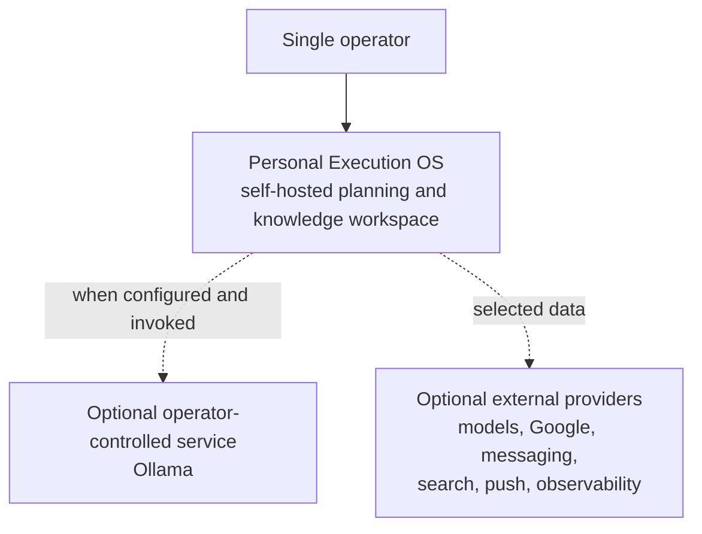

The dotted connections are disclosure and availability boundaries, not
required dependencies. The default local workspace starts without them.

## Container and data-store view

Inside the system boundary, the supported deployment has a browser client,
edge, modular-monolith API, separate worker process, and two data stores.

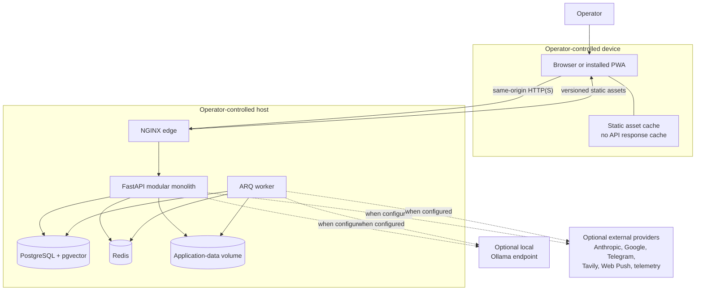

The browser cache contains only versioned application assets and icons. It
does not cache API responses, authentication routes, personal records, or page
navigations. The application-data volume can contain evaluation, export, and
operational artifacts. If those files matter, include that volume in the
backup plan alongside PostgreSQL.

## Supported deployment topology

Docker Compose is the supported installation contract. It creates six
long-running or one-shot service roles and three networks.

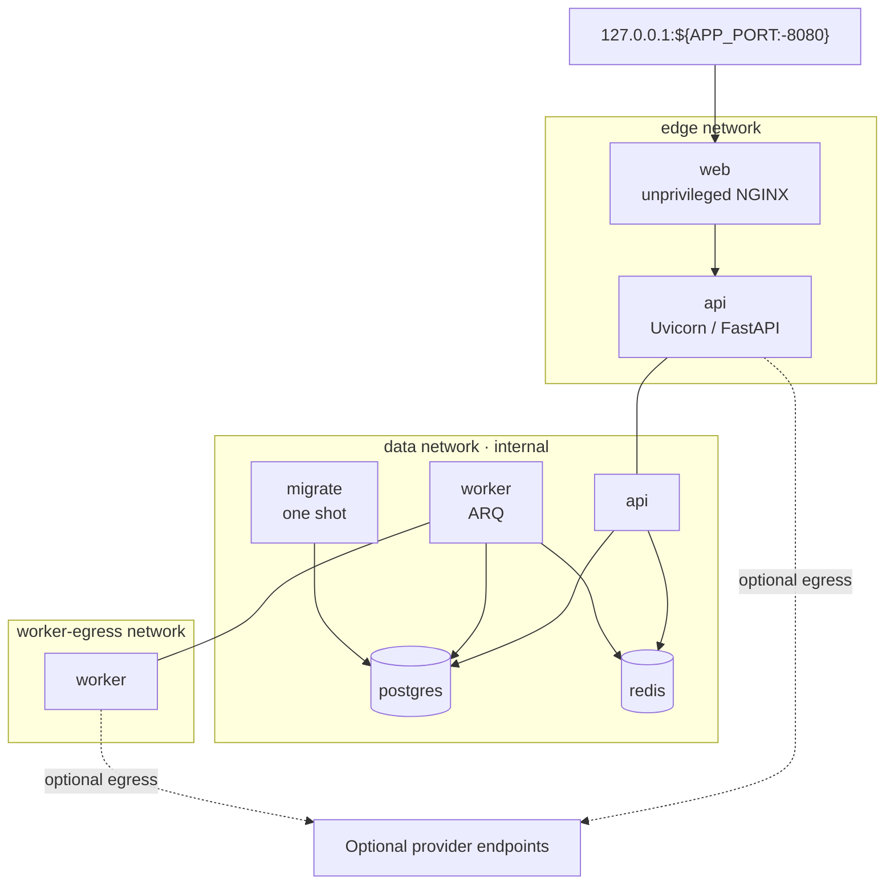

The repeated API and worker nodes represent one container attached to more
than one network:

- **web:** joins `edge` only and publishes the loopback port. Unprivileged NGINX
  serves the PWA, applies edge headers/Host policy, and proxies API/streaming
  routes from a read-only filesystem.
- **api:** joins `edge` and internal `data`. The non-root backend image owns
  HTTP lifecycle, authentication, domain services, and optional provider calls;
  only temporary and application-data mounts are writable.
- **worker:** joins internal `data` and `worker-egress`. The same restricted
  backend image runs queues, schedules, maintenance, and optional delivery.
- **migrate:** joins internal `data` and exits after applying Alembic migrations
  and runtime grants with the migration-owner credential.
- **postgres:** joins internal `data`; its named volume is the durable source of
  truth and its policies enforce row scope.
- **redis:** joins internal `data`; append-only persistence and no eviction
  support queues, rate limits, and short-lived coordination.

NGINX cannot resolve PostgreSQL or Redis because it never joins the data
network. PostgreSQL, Redis, the API, and the worker publish no host ports. The
API can make optional outbound calls through its edge attachment. The worker
has a separate egress network, while its data-network membership remains
internal. This separates connectivity but does not restrict outbound traffic
to an allowlist. Disabled feature gates and blank credentials prevent expected
provider calls. A compromised API or worker process would still have general
outbound network access.

The root `.env` is supplied to both the API and worker because either process
may run an enabled integration. This is a broad credential boundary within the
backend tier, not per-job secret isolation. Redis has no application password
in the supported stack and relies on the internal Docker network plus the
absence of a published port. Treat host or Docker-daemon compromise as outside
what these controls can contain.

See [ADR-0001](decisions/ADR-0001-single-owner-compose.md) for the deployment
choice and [ADR-0006](decisions/ADR-0006-least-privilege-database-access.md) for
database authority.

## HTTP request lifecycle

An authenticated mutation follows this path:

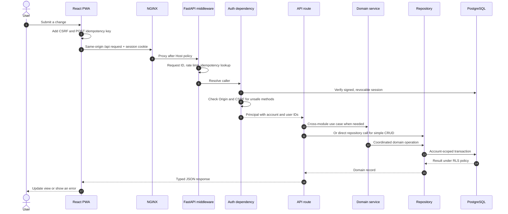

The concrete entry points are:

- `frontend/src/api/client.ts` adds same-origin credentials, CSRF headers for
  unsafe methods, and an idempotency key for `POST`.
- `docker/nginx-site.conf.template` serves static assets and proxies `/api`,
  health, webhook, and server-sent-event routes.
- `src/app/main.py` creates the FastAPI application, controls middleware order,
  registers routes, and owns startup and shutdown.
- `src/app/api/deps.py` resolves the principal and attaches its account and user
  identifiers to the request's SQLAlchemy session.
- `src/app/api/routes/` validates transport-level input and maps domain results
  to response DTOs.
- `src/app/domain/services/` coordinates multi-step application behavior.
- `src/app/persistence/repositories/` contains reusable persistence queries.

### Why these layers exist

Routes understand HTTP but should not own reusable business behavior.
Repositories understand persistence but should not decide product policy.
Services sit between routes and repositories when an operation spans records,
providers, approvals, or runtime state; simple CRUD routes may call a
repository directly. This is a modular monolith rather than a set of networked
microservices: boundaries are Python and TypeScript module boundaries, so a
contributor can trace and test a feature without operating a distributed
system.

See [ADR-0002](decisions/ADR-0002-modular-monolith.md).

## Authentication and session boundary

The production browser flow is local-owner authentication. API-key and bearer
authentication remain available for explicit server-to-server or legacy
development use when `CHAT_API_KEY` is configured; the production browser does
not store that key.

> **First-run boundary:** `/api/setup/initialize` has no authentication until
> the singleton owner credential is created. Never expose
> an uninitialized installation to an untrusted network. Complete setup on
> loopback before configuring remote access.

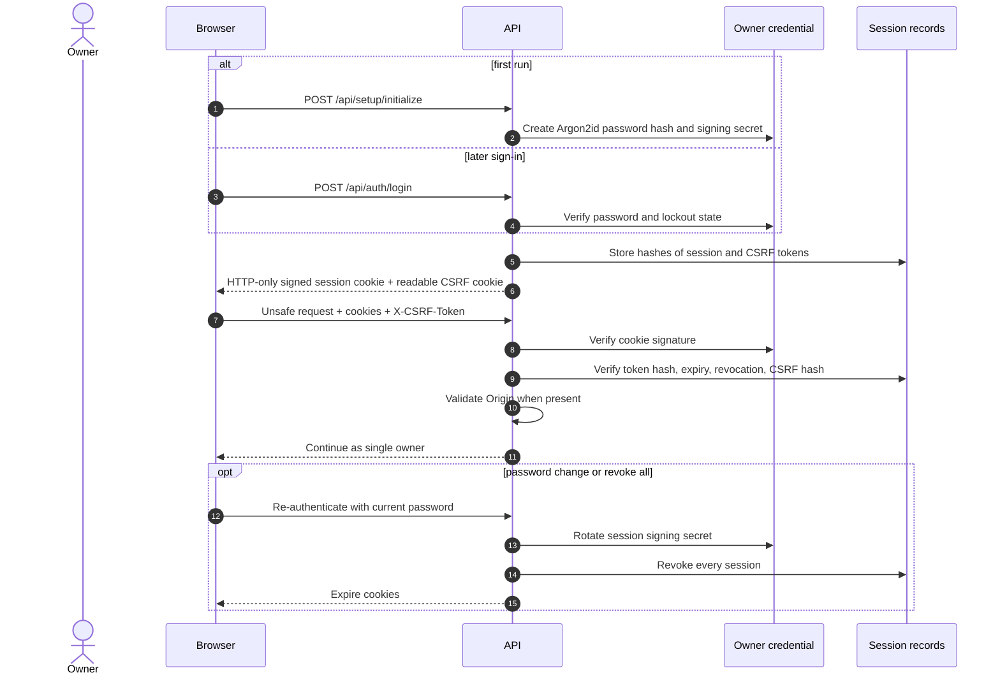

Session properties:

- The password is hashed with Argon2id.
- The raw server-side session token and CSRF token are not stored in
  PostgreSQL; their hashes are.
- The signed session cookie is HTTP-only, `SameSite=Lax`, and secure when
  `AUTH_COOKIE_SECURE` is enabled for HTTPS.
- Unsafe cookie-authenticated methods validate the `Origin` header when the
  browser sends one and require a double-submit CSRF value that also matches
  the server-side hash. Host validation applies independently.
- Login and credential mutations have rate limits and temporary lockout
  behavior.
- Password changes and "revoke all" rotate the signing secret as well as
  revoking current records.

The identity model supports one owner. It is not ready for a production
multi-user deployment. See
[ADR-0001](decisions/ADR-0001-single-owner-compose.md) and the
[security policy](../SECURITY.md).

## Trust boundary model

The diagrams above show connections; this section defines how each boundary is
treated.

- **Browser input is untrusted.** Validate with Pydantic, authorize the caller,
  bound parsing, and render safely.
- **Connector documents, email, webpages, and provider output are untrusted
  data, never policy.** Label trust, resist prompt injection, validate schemas,
  and never let content escalate authority.
- **Model output is a proposal.** Deterministic policy validates arguments,
  feature gates, and approval or standing authorization.
- **Session and CSRF cookies are bearer-like device secrets.** Use an HTTP-only
  session cookie, server-side hashes, expiry, revocation, Origin checks when
  present, and CSRF validation.
- **PostgreSQL is sensitive durable data.** Keep it on the internal network and
  apply the least-privilege role, account scope, RLS, and backup protection.
- **Redis is sensitive transient data.** Do not publish its port or keep the
  only durable truth there; apply TTLs and protect the host.
- **The application-data volume contains sensitive generated files.** Restrict
  host access and give it a separate backup/deletion decision.
- **The API/worker environment is a shared backend credential boundary.** Keep
  `.env` private, restrict host access, redact logs, and rotate credentials.
- **An optional provider is a disclosure and availability boundary.** Start
  blank/off, use least privilege, document the flow, and revoke/delete
  provider-side.
- **Enabled automation has standing authority only within its configuration.**
  Require individual opt-in, bounded destination/action, audit evidence, and a
  clear disable procedure.

There are two approval models:

- **Per-action approval** applies to dormant ad-hoc mutating tool plans. A model
  proposal cannot cross that boundary on its own.
- **Standing operator authorization** applies when the operator explicitly
  enables and configures a bounded alert, notification, Web Push, or issue
  filing system. Those jobs do not prompt for every event.

Neither model turns arbitrary model output into general provider authority.

## Data and persistence model

PostgreSQL owns durable user and runtime records. The schema is broader than a
simple task manager because it represents three related systems:

1. a planning system,
2. a knowledge and relationship system, and
3. an inspectable execution runtime.

The diagram groups representative tables; it is a conceptual map rather than a
replacement for Alembic migrations.

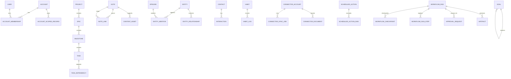

Most user-facing models inherit an account-scoped mixin. SQLAlchemy attaches
the verified account to the session, adds ORM criteria to scoped reads, stamps
new scoped rows, and rejects cross-account mutations. At transaction start it
also sets PostgreSQL-local `app.account_id` and `app.user_id` settings. RLS
policies compare row ownership to those values.

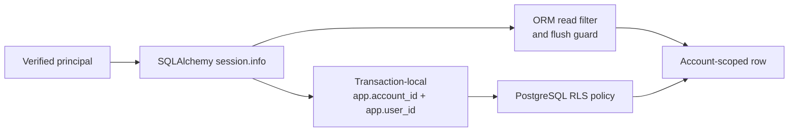

This is defence in depth, not two independent identity systems. Both layers
depend on correct principal scoping. Background jobs receive the same fixed
single-owner scope. The Compose API and worker connect as `assistant_runtime`,
a non-owner role, so enabled RLS policies apply. Schema migrations use
`assistant_migrator`; database bootstrap uses `assistant_admin`.

Alembic migrations are the schema history and authority. ORM models describe
the current application view but are not a substitute for a migration.

See [ADR-0003](decisions/ADR-0003-postgres-durable-redis-transient.md) and
[ADR-0006](decisions/ADR-0006-least-privilege-database-access.md).

## Model-backed message lifecycle

Model-backed chat is optional. With `LLM_PROVIDER=disabled`, core CRUD,
structured search, local views, export, backup, and authentication continue to
work; model-dependent paths report that the provider is unavailable.

When enabled, `process_message()` is the primary orchestration path:

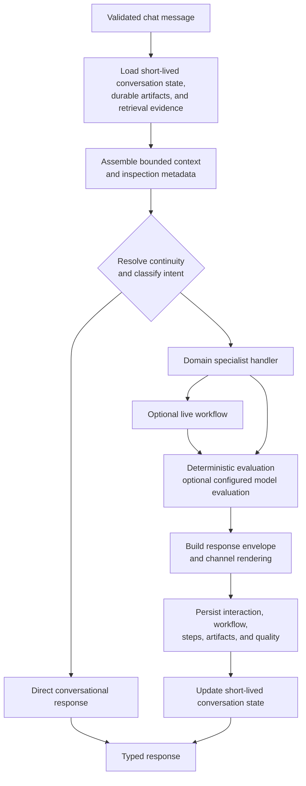

The detailed stages are:

1. Create request, trace, workflow, and trust identifiers.
2. Load recent conversation messages, rolling summary, session state packet,
   pending approval or planning state, and durable artifacts.
3. Retrieve relevant structured context and, only when records already contain
   embeddings, compatible vector context. The public release has no supported
   fresh-install embedding indexer.
4. Assemble context within explicit budgets.
5. Resume an interrupted flow when possible; otherwise apply deterministic
   routing heuristics and then model classification when needed.
6. Invoke the specialist handler or an eligible live workflow.
7. Evaluate the response, render a channel-specific envelope, and record
   quality metadata.
8. Persist workflow steps, interaction records, artifacts, trace information,
   and any approval state.
9. Update Redis-backed short-lived conversation continuity.

The main implementation is in:

- `src/app/domain/services/chat.py` for the end-to-end service pipeline,
- `src/app/domain/services/orchestrator.py` for intent classification,
- `src/app/domain/services/handlers/` for specialist-facing application logic,
- `src/app/agents/` for prompts, specialist implementations, graphs, and tool
  compatibility code,
- `src/app/core/context_engine.py`, `state_packet.py`, and
  `workflow_runtime.py` for bounded context and workflow mechanics,
- `src/app/persistence/repositories/runtime_records.py` for durable runtime
  evidence.

The two orchestration layers have different jobs. `domain/services/chat.py` is
the supported application pipeline. It owns context, evaluation, persistence,
continuity, and degradation. The LangGraph graph under `agents/graphs/` is used
for specialist routing and workflow experiments. Some specialists run
directly through the service layer, so a graph node is not necessarily a
public runtime entry point.

See [ADR-0007](decisions/ADR-0007-models-propose-code-authorizes.md).

## Side effects and approval

The public release does not enable MCP execution, and its supported Google
connectors are read-only. The codebase nevertheless retains a dormant,
test-covered per-action approval design for any future ad-hoc tool runtime:

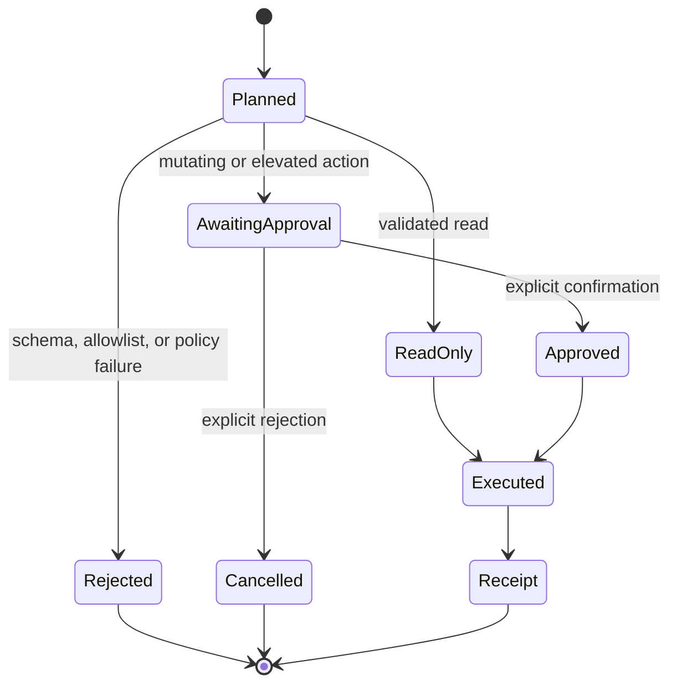

A prompt cannot grant permission. Tool names must be allowed, arguments must
match deterministic schemas, and instruction-like content from an untrusted
source can raise the confirmation requirement. Mutations must pause, previews
must mask secrets, and execution receipts must include idempotency evidence.

This design documents a safety boundary, not a supported capability claim.
Read [CAPABILITIES.md](CAPABILITIES.md#dormant-or-unsupported-in-this-release)
before changing its status. Separately enabled alert, notification, push, and
issue-filing jobs use the operator's narrow configuration as standing
authorization, as described in the trust model above.

## Queued and scheduled work

The API and worker use the same backend image but different process
entrypoints. ARQ uses Redis for queue transport and schedule coordination.
Durable business results and workflow evidence return to PostgreSQL.

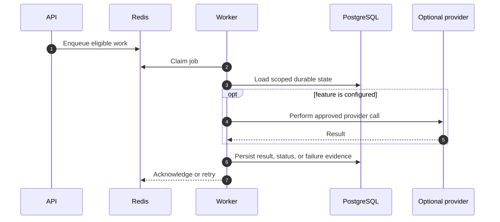

`src/app/workers/main.py` constructs the schedule from settings and supplies
worker startup and shutdown hooks. Its core schedule is always registered, but
most jobs in that group immediately no-op unless their own feature settings
are enabled. The model-dependent schedule is added only when both a model and
`PROACTIVE_AUTOMATION_ENABLED` are configured. Weekly evaluation-dataset
curation is a separately gated scheduled job. By contrast, the general
`curation` task in `workers/agent_tasks.py` has no supported enqueue or schedule
in this release.

Scheduled actions reuse the chat runtime rather than creating a second
reasoning path. A run is recorded before execution, then completed or failed
with a notification. If a response requires confirmation, it remains an
approval request rather than becoming authority to act.

## External data boundaries

Every provider integration adds decisions about disclosure, credentials, cost,
retention, and availability. Configuration alone does not send application
data; the relevant feature must also run.

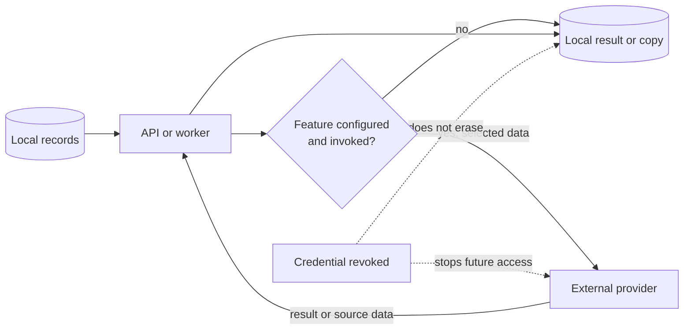

Provider revocation does not automatically erase local copies, exports,
backups, browser data, logs, or provider-retained data. The exact scopes and
disable procedures are maintained in [INTEGRATIONS.md](INTEGRATIONS.md);
[PRIVACY.md](PRIVACY.md) covers deletion boundaries.

See [ADR-0005](decisions/ADR-0005-optional-providers-fail-closed.md).

## Backup and recovery boundary

The supported recovery scripts pair a verified PostgreSQL dump with a
versioned archive of private local configuration and `app-data`. They do not
create an atomic complete-machine snapshot.

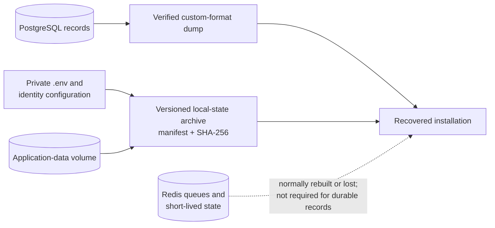

`scripts/backup-database.sh` creates and verifies a logical PostgreSQL archive.
`scripts/restore-database.sh` replaces the live database and therefore requires
a confirmation flag. `scripts/backup-local-state.sh` and
`scripts/restore-local-state.sh` separately protect the stopped `app-data`
volume and private local configuration in a versioned, checksummed format. A
complete recovery plan must also protect:

- TLS, DNS, reverse-proxy, and provider configuration owned outside this
  repository.

Redis loss can remove queued work and conversation continuity. Durable workflow
records and checkpoints can preserve evidence, but they do not reconstruct
every in-flight Redis item. Test the recovery scope you actually depend on.
See [Backup and recovery](BACKUP_AND_RECOVERY.md),
[Setup: back up](SETUP.md#back-up), and
[ADR-0008](decisions/ADR-0008-backup-scope.md).

## Failure and degradation model

Not every failure should take down the local workspace. The response depends
on whether the failure affects an optional feature, secondary work, or a
durable database operation.

- **Model provider disabled:** report the model-backed feature as unavailable
  while retaining the local core; optional providers are not boot dependencies.
- **Redis conversation context unavailable:** continue with less continuity
  where safe and mark degradation; transient context is not durable truth.
- **Supporting retrieval fails:** continue without retrieved evidence where
  safe and expose degraded trace metadata; never invent durable records.
- **Authoritative database operation fails:** roll back and return a safe
  error; partial durable writes are worse than a failed request.
- **Runtime evidence persistence fails after response formation:** roll back
  that persistence unit and mark degradation where possible; observability
  cannot silently change the user operation.
- **Optional provider startup fails:** log a bounded warning and retain the
  local core.
- **Worker job fails:** record or log the failure, then follow that job's
  bounded retry/dead-letter policy.
- **Health dependency fails:** liveness can remain up while readiness fails;
  process existence is not proof of useful service.

`AppError` subclasses map known application failures to stable, user-safe
responses. Unhandled errors are logged with a request ID and returned without
raw exception details. The request ID, trace ID, workflow ID, response ID, and
tool idempotency key are different identifiers with different lifetimes; do not
collapse them into one field.

## Observability without default disclosure

Structured logging and internal runtime records are available locally.
External Sentry, PostHog, OpenTelemetry, heartbeat, and alert destinations are
optional. Content export through OpenTelemetry has a separate off-by-default
control.

The observability design follows three rules:

- correlate work without treating raw personal content as metadata,
- keep external export disabled until the destination is approved,
- allow tracing or evaluation failure to degrade explicitly rather than
  quietly changing the primary operation.

Operational dashboards are useful evidence, but they do not replace
PostgreSQL backups, provider audit logs, or security monitoring of the host.

## Frontend architecture

The frontend is a route-split React application:

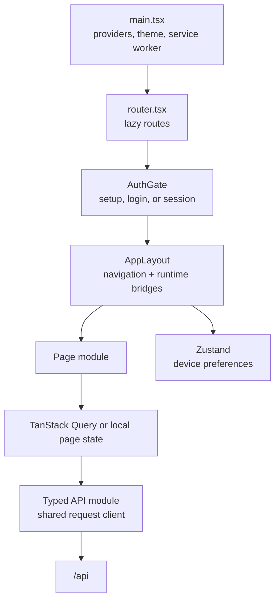

- `frontend/src/pages/` owns route-level composition.
- `frontend/src/components/` owns reusable feature and UI components.
- `frontend/src/api/` owns transport functions; generated OpenAPI artifacts are
  under `frontend/src/api/generated/`.
- TanStack Query owns server-state freshness and request caching. Zustand is
  used for small device-local preferences and UI state, not as a second
  database.
- `frontend/e2e/` covers critical browser paths, phone viewports, PWA behavior,
  and WCAG-oriented accessibility checks.

The service worker caches assets only. Supporting personal records offline
would create a second durable data store and bring new encryption,
invalidation, deletion, conflict, and recovery requirements. This release does
not meet those requirements.

See [ADR-0004](decisions/ADR-0004-progressive-web-app.md).

## Repository map

### Backend

- `src/app/main.py`: construction, lifecycle, middleware, and routes; start at
  `create_app()` and `lifespan()`.
- `src/app/config.py`: typed settings and gates; start at `Settings`.
- `src/app/api/`: HTTP dependencies, middleware, schemas, routes, idempotency,
  and limits; start at `deps.py`, then the feature route.
- `src/app/domain/models.py`: transport-independent contracts; start at
  `MessageInput`, `ChatResponse`, and `Specialist`.
- `src/app/domain/services/`: application use cases; use the feature service or
  `chat.py` for model orchestration.
- `src/app/domain/services/handlers/`: chat specialist adapters; read
  `_common.py`, then one handler.
- `src/app/agents/`: prompts, model calls, graphs, and dormant compatibility;
  start at the relevant prompt/specialist, not the legacy graph.
- `src/app/core/`: security, context, evaluation, telemetry, and adapters;
  follow imports from the use case.
- `src/app/persistence/models.py`: current ORM view; read scope mixins before a
  feature model.
- `src/app/persistence/repositories/`: reusable durable queries; choose the
  repository matching the route.
- `src/app/persistence/migrations/`: schema and policy history;
  inspect the newest relevant revision.
- `src/app/workers/`: queues, schedules, and maintenance; start at `main.py`.
- `src/app/second_brain/`: knowledge algorithms; start at the relevant
  processor.

### Frontend, evidence, and operations

- `frontend/src/main.tsx` and `router.tsx`: browser bootstrap and route tree.
- `frontend/src/api/`: HTTP boundary; read `client.ts`, then a resource module.
- `frontend/src/pages/` and `components/`: route experiences and reusable UI.
- `tests/unit/`: isolated behavior; match the implementation module.
- `tests/integration/`: cross-layer API and real-PostgreSQL evidence.
- `tests/contract/`: generated and behavioral OpenAPI checks.
- `tests/evaluation/`: retrieval and model-quality evidence.
- `frontend/e2e/`: browser, phone, PWA, and accessibility acceptance.
- `scripts/`: setup, release, privacy, evaluation, backup, and recovery tools.
- `docker/` and `compose.yml`: runtime and network boundary; read Compose first.
- `config/`: public behavior contract and ignored identity override.
- `data/evaluation/`: fictional rubrics, fixtures, and baselines.

The [developer guide](DEVELOPER_GUIDE.md) turns this map into feature-specific
change recipes.

## Design choices and alternatives

The main architectural trade-offs are:

- **Deployment:** single-owner Compose over hosted SaaS, native packaging, or
  Kubernetes. The supported host needs Docker Compose and a POSIX shell; the
  operator owns TLS, updates, and backups.
- **Application shape:** modular monolith plus worker over microservices,
  serverless functions, or one giant module. Cross-module work can share a
  database transaction; contributors must maintain the module boundaries.
- **State:** PostgreSQL durable and Redis transient over Redis-primary, local
  files, or provider-owned state. PostgreSQL supplies relational queries and
  dump/restore tooling, and every supported installation must operate it.
- **Mobile:** responsive PWA over separate native apps. One codebase serves
  phones and desktops; there is no native background/offline guarantee.
- **Providers:** optional and fail-closed over a mandatory cloud or silent
  fallback. Core local records remain available when provider features are
  disabled or unavailable.
- **Isolation:** runtime role plus ORM scope plus RLS over application filters
  alone. Defence in depth depends on correct migrations and worker scope.
- **AI authority:** model proposals plus deterministic policy over free-form
  autonomous execution. Application code validates schemas, permissions, and
  feature gates before a supported side effect can run.
- **API:** FastAPI/Pydantic plus checked OpenAPI over duplicate hand-maintained
  schemas or GraphQL. CI compares generated output with the checked-in
  contract, so source changes require regeneration.

The full records are under [docs/decisions](decisions/README.md). When the
context changes, add a superseding decision instead of rewriting the old one.

## Architectural invariants

A change is incompatible with the current architecture if it silently breaks
one of these rules:

- The default installation must boot without an external model or provider
  account.
- Personal defaults and identities must not be committed or baked into images.
- PostgreSQL is the durable source of truth for supported personal records.
- Redis loss must not be equivalent to losing the durable workspace.
- Browser production authentication must not place API keys in web storage.
- Account-scoped access must preserve both application scoping and effective
  RLS under the runtime role.
- Provider transmission must be documented, configurable, and disabled by
  default.
- Model output alone is not authorization for a consequential side effect.
- The PWA must not cache authenticated API responses or personal records.
- Background systems that can spend money, export data, or remove data must
  remain individually opt-in.
- Tests, examples, screenshots, and evaluation assets must be safe to publish.

Changing an invariant requires an explicit proposal, updated threat and
privacy analysis, a new or superseding ADR, migration and rollback planning,
and tests at the affected boundary.

## Known architectural debt

Current limits:

- It has not had an independent security review.
- It is a single-owner runtime over a schema with inherited account concepts,
  not a supported multi-tenant service.
- The migration chain predates the public baseline and needs consolidation.
- Some large API, worker, orchestration, and frontend modules need splitting.
- Dormant MCP compatibility code should be removed or given a separately
  sandboxed, supported runtime.
- PostgreSQL backup is supported, but complete machine recovery also requires
  private configuration and application-volume coverage.
- Phone behavior needs broader physical-device validation.

The maintained list is in [ROADMAP.md](ROADMAP.md). Debt belongs in the
architecture narrative when it affects how a reader should interpret the
current design.
