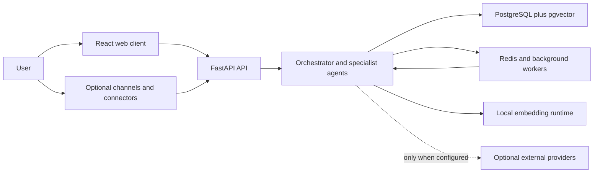

# Architecture

Personal Execution OS is a self-hosted application with explicit boundaries
between interaction channels, agent reasoning, state, and external providers.

## Components

### Web client

`frontend/` contains the React and TypeScript application. It communicates with
the API over HTTP and streaming endpoints. Browser storage, service workers,
push subscriptions, and cached responses are part of the user's privacy
boundary.

### API

`src/app/api/` contains FastAPI routes, authentication dependencies,
rate-limiting, idempotency, and request middleware. Health endpoints separate
liveness from dependency readiness.

### Domain and agent runtime

`src/app/domain/` holds service-level behavior. `src/app/agents/` contains
routing, specialist workflows, prompts, tools, and graph orchestration.
Consequential external actions should pass through approval and policy
boundaries rather than being executed directly from model output.

### Persistence

PostgreSQL is the durable source of truth. `pgvector` supports semantic
retrieval. Alembic manages schema changes. Redis supports queues, coordination,
rate limits, and short-lived runtime state; it is not the authoritative store
for personal records.

The Compose runtime separates database authority:

- `assistant_admin` bootstraps roles and extensions.
- `assistant_migrator` owns schema objects and applies migrations.
- `assistant_runtime` serves API and worker queries without superuser, database
  creation, role creation, or table-owner privileges.

Account-scoped tables use PostgreSQL row-level-security policies. Application
sessions set the single-owner account and user identifiers inside each
transaction. ORM account filters remain a second application-layer boundary.
The web proxy joins only the edge network, so it cannot resolve or connect to
PostgreSQL and Redis on the internal data network.

### Workers

ARQ workers execute scheduled actions, consolidation, evaluation, notifications,
and maintenance away from request latency. Worker and API processes share the
same configuration and database.

### Optional providers

Model APIs, messaging, email, calendar, search, error reporting, analytics, and
OpenTelemetry collectors sit outside the trusted local boundary. They receive
data only when their feature is configured and invoked. The operator must
evaluate each provider independently.

## Trust boundaries

1. **User input is untrusted.** It can contain prompt-injection text, malformed
   data, or links to hostile content.
2. **Connector content is untrusted data, not instructions.** Email, webpages,
   documents, and tool responses must not override system policy.
3. **Model output is a proposal.** Validate schemas, destinations, permissions,
   and confirmation state before performing side effects.
4. **The database contains sensitive personal data.** Use least-privilege roles,
   encrypted transport, restricted network access, and tested backups.
5. **Telemetry is an external disclosure boundary.** Keep payload capture and
   default PII transmission disabled.
6. **The browser is a separate data surface.** Treat push endpoints, caches,
   local storage, screenshots, and developer traces as sensitive.

## Configuration

Runtime settings come from environment variables. Public examples are stored in
`.env.example`; secrets stay in `.env` or an external secrets manager. Personal
identity context belongs in ignored local configuration, based on
`config/IDENTITY.example.md`. Compose mounts that local file read-only at
runtime and excludes it from image builds.

## Repository map

- `src/app/`: backend application
- `frontend/`: web and progressive web client
- `tests/`: backend, contract, integration, and evaluation tests
- `scripts/`: development, evaluation, and privacy tooling
- `config/`: generic behavior contracts and local-override templates
- `data/evaluation/`: synthetic or reviewed evaluation assets
- `compose.yml`: supported one-command self-hosted stack
- `docker/`: container images and reverse-proxy configuration
- `docs/`: operator and contributor documentation

## Design constraints

- Self-hosting and inspectability take priority over hosted-service coupling.
- Optional providers must fail closed or degrade clearly when unconfigured.
- Personal defaults must be local data, not repository constants.
- Tests and evaluation data must be fictional and safe to publish.
- No deployment workflow has access to user infrastructure.
