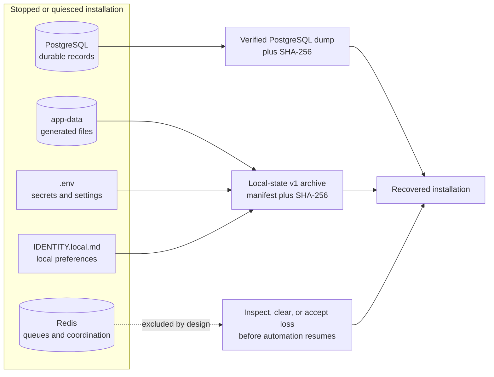

# Backup and recovery

Personal Execution OS has two supported recovery artifacts because it has two
different kinds of durable local state:

1. PostgreSQL is the durable source of truth for application records.
2. The `app-data` volume and private local configuration contain generated
   files, operational artifacts, credentials, and the key needed to decrypt
   stored connector tokens.

Redis is deliberately outside both artifacts. It holds queues and short-lived
coordination state, not the authoritative application record. Restoring an old
Redis snapshot can replay stale work, so the recovery workflow requires an
explicit Redis decision instead of silently treating it as durable truth.



Neither script encrypts its output. Both artifacts contain sensitive personal
data; the local-state archive also contains credentials in plain text. Keep
them with mode `0600`, encrypt every off-host copy, control access, define a
retention period, and test restoration on an isolated installation.

## What each artifact covers

| State | Supported artifact | Why |
| --- | --- | --- |
| PostgreSQL records and vectors | `backup-database.sh` custom-format dump | Logical dump is portable and is test-restored before release |
| `.env` | Local-state archive | Includes service credentials and `CONNECTOR_TOKEN_ENCRYPTION_KEY` |
| `config/IDENTITY.local.md` | Local-state archive | Includes owner-specific preferences intentionally excluded from Git |
| `app-data` volume | Local-state archive | Includes evaluation exports, spot checks, dataset proposals, and other generated files |
| Redis | Excluded | Queues and short-lived state are not authoritative and may be unsafe to replay |
| TLS, DNS, proxy, firewall, provider accounts | Operator-managed | These live outside the repository and Docker volumes |
| Browser caches and downloaded exports | Operator-managed | These live on client devices or in user-selected destinations |

A recovery set is therefore the four files below, kept together:

```text
personal-execution-os-20260802T120000Z.dump
personal-execution-os-20260802T120000Z.dump.sha256
personal-execution-os-local-state-20260802T120000Z.tar.gz
personal-execution-os-local-state-20260802T120000Z.tar.gz.sha256
```

The timestamps do not need to match exactly. Record which database dump and
local-state archive form one recovery point.

## Create a coherent recovery set

Stop application writers first, leave PostgreSQL available long enough to
produce its verified logical dump, and then stop the remaining stack before
copying the application-data volume:

```sh
docker compose stop web api worker
./scripts/backup-database.sh
docker compose down
./scripts/backup-local-state.sh
docker compose up --detach --wait
```

`docker compose down` without `--volumes` removes containers and networks but
preserves all named volumes. Do not add `--volumes` to either backup or restore
preparation.

The local-state backup refuses to run when any container in the Compose
project is active. This is stricter than checking only the API and worker: it
avoids a file-level archive whose contents can change while tar is reading
them. It also refuses:

- an existing output archive or checksum sidecar;
- missing, linked, or non-regular private configuration files;
- a missing application-data volume;
- an unsafe volume name;
- a generated inner archive containing links, special files, duplicate paths,
  absolute paths, or `..` traversal.

Supply an explicit destination when required:

```sh
./scripts/backup-local-state.sh \
  /encrypted-backup-destination/peos-local-state-20260802T120000Z.tar.gz
```

The filename must end in `.tar.gz`. The script creates the parent directory
when needed but never overwrites an existing archive or sidecar.

## Local-state archive format

The current format identifier is `personal-execution-os-local-state`, version
`1`. It is a gzip-compressed POSIX tar archive with exactly this member set:

```text
personal-execution-os-local-state-v1/
├── FORMAT
├── METADATA
├── MANIFEST.sha256
├── app-data.tar
├── config.env
└── IDENTITY.local.md
```

The fixed structure is part of the security boundary.
Restore rejects missing, duplicate, additional, linked, or unsupported
members before extraction.

`FORMAT` contains:

```text
personal-execution-os-local-state
version=1
```

`METADATA` records:

- creation time in UTC;
- the source Git revision, or `unknown` outside a Git checkout;
- the exact included scope;
- the explicit PostgreSQL and Redis exclusions.

`MANIFEST.sha256` binds the SHA-256 digest of each payload to its exact fixed
name. The external `.sha256` sidecar separately binds the digest of the whole
compressed archive to the selected archive filename. Restore requires both
integrity layers:

1. The sidecar detects truncation, replacement, or transport corruption before
   archive extraction.
2. The internal manifest authenticates the version marker, metadata, volume
   payload, and both private configuration payloads independently.

These hashes detect accidental or malicious modification but do not provide
authenticity against an attacker who can replace both the archive and its
hashes. Store recovery sets in an access-controlled, authenticated backup
system.

The archive and sidecar are mode `0600`. Temporary directories are mode
`0700`, and restored `.env` and `config/IDENTITY.local.md` are forced to mode
`0600`. The application-data tar preserves directory and regular-file metadata.

## Restore

Restoration replaces `.env`, `config/IDENTITY.local.md`, and every existing
entry in the `app-data` volume. Use an isolated drill before relying on it.

1. Check out the source revision recorded in the archive metadata, or a
   documented compatible revision.
2. Place the local-state archive beside its required `.sha256` sidecar.
3. Stop the entire stack without deleting volumes.
4. Restore local state.
5. Start PostgreSQL and Redis.
6. Restore the separately verified database dump.
7. Resolve the Redis and external-provider state before enabling automation.

```sh
docker compose down

./scripts/restore-local-state.sh \
  backups/personal-execution-os-local-state-20260802T120000Z.tar.gz \
  --confirm-replace-local-state

docker compose up --detach postgres redis

./scripts/restore-database.sh \
  backups/personal-execution-os-20260802T120000Z.dump \
  --confirm-destroy-local-data
```

The local-state restore never starts application services. The database
restore applies migrations and starts the healthy stack only after its own
verification succeeds.

Restore checks the outer checksum, fixed archive schema, member types,
internal manifest, format version, and inner application-data paths before it
contacts Docker or changes local state. It then:

1. refuses if any project container is active;
2. refuses symlinked or non-regular configuration destinations;
3. accepts either a complete existing installation or a completely clean
   destination, but rejects ambiguous partial state;
4. creates a versioned, checksummed pre-restore local-state safety archive when
   complete existing state is present;
5. proves the volume payload can be extracted into a temporary Docker volume;
6. replaces the application-data contents and atomically moves private
   configuration files into place;
7. attempts rollback from the safety archive if replacement fails.

On a clean destination there is no prior state to preserve. If replacement
fails, the helper removes only the incomplete newly created local state and
leaves services stopped.

The restore helper uses the Compose project name to identify active containers
and the application-data volume. The defaults are:

```text
COMPOSE_PROJECT_NAME=personal-execution-os
PEOS_APP_DATA_VOLUME=personal-execution-os_app-data
```

Set both variables consistently only when the installation deliberately uses
a different project or volume name. Volume names are restricted to letters,
numbers, `.`, `_`, and `-`.

## Redis after disaster recovery

The helper does not read, archive, restore, clear, or delete the Redis volume.
This is intentional.

- On a clean machine, Compose creates a new empty Redis volume.
- On an existing machine, an old Redis volume may contain queued or in-flight
  work that no longer matches restored PostgreSQL or external provider state.
- Redis loss can remove conversation continuity and queued work, but it does
  not replace the authoritative PostgreSQL records.

Keep the application stopped until the operator has decided whether any
existing Redis state is safe to retain. Inspect pending automation,
provider-side effects, dead-letter records, and workflow checkpoints before
resuming the worker. Do not restore an old Redis AOF merely to make the
recovery set look complete.

## Why the format is split

Several simpler options were rejected:

- **Copy a live Docker volume:** file contents can change during the copy and
  the resulting archive has no stable recovery boundary.
- **Copy PostgreSQL's raw volume:** a filesystem copy is less portable and
  does not prove a logical restore.
- **Put the database dump inside the local archive:** this obscures which
  verification applies to each artifact and makes safe sequencing harder.
- **Include Redis automatically:** an old queue can repeat side effects and
  contradict restored durable workflow state.
- **Extract arbitrary tar members:** links, special files, absolute paths, and
  traversal entries can write outside the intended recovery target.
- **Overwrite an existing backup path:** a typo could destroy the last known
  recovery point before a new one has been verified.

The two-artifact design keeps the database workflow independently testable,
makes every exclusion explicit, and allows operators to retain generated files
and decryption keys without claiming an atomic whole-machine snapshot.

## Recovery drill

Run this drill with disposable data and a separate Compose project:

1. Create both supported artifacts.
2. Copy them to an isolated checkout of the recorded revision.
3. Set a unique `COMPOSE_PROJECT_NAME` and matching
   `PEOS_APP_DATA_VOLUME`.
4. Restore local state while that project has no active containers.
5. Start only its PostgreSQL and Redis services.
6. Restore the database dump.
7. Confirm login, connector-token decryption, representative records,
   evaluation/export files, and scheduled-action state.
8. Confirm no stale provider action or Redis job executes unexpectedly.
9. Record the archive names, source revision, elapsed recovery time, and any
   manual host/provider steps.
10. Retain or securely destroy the drill copies according to the same backup
    policy.

A checksum verification alone is not a recovery drill. The evidence that
matters is a successful, isolated restore followed by application-level checks.

## Failure messages and operator response

| Failure | Meaning | Safe response |
| --- | --- | --- |
| Services are running | A container could hold or mutate state | Run `docker compose down` without `--volumes`, then retry |
| Existing output refused | The selected backup name is already occupied | Choose a new filename; do not delete the old artifact until retention review |
| Checksum mismatch | Archive changed after its sidecar was created | Quarantine both files and use another verified recovery set |
| Unexpected archive member | Format is corrupt, unsupported, or hostile | Do not extract it manually into the project; inspect only in an isolated environment |
| Partial existing state | Some recovery targets exist and others do not | Back up and reconcile the partial installation before retrying |
| Verification extraction failed | The app-data payload cannot be safely unpacked | Live state is unchanged; use another archive |
| Restore failed and rollback succeeded | Requested state was not installed | Keep services stopped, preserve both archives, and investigate |
| Rollback failed | Live state may be partial | Keep services stopped and recover from the printed safety archive in an isolated workflow |

## Retention and deletion

Deleting live application records does not delete old dumps or local-state
archives. A retirement or privacy-erasure procedure must cover:

- every `.dump`, `.tar.gz`, and matching checksum;
- automatic pre-restore safety archives;
- encrypted off-host copies and backup-provider retention;
- copied exports and drill installations;
- the live PostgreSQL, Redis, and application-data volumes;
- `.env`, local identity, browser data, and provider-retained records.

Never make archive deletion part of a restore command. Review retention and
verify a newer recovery point before destroying an older one.
