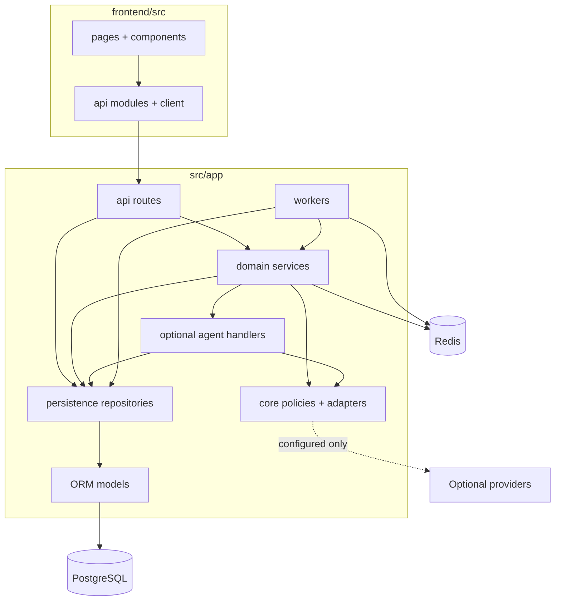
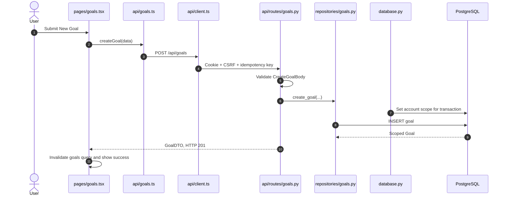
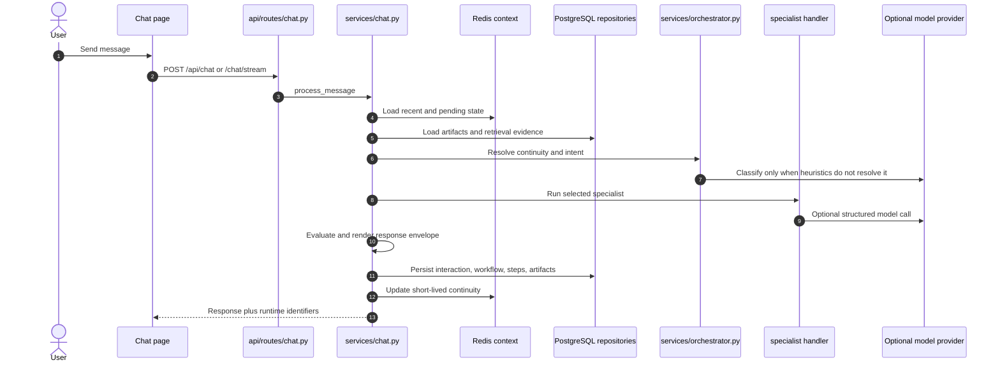

# Developer guide

This guide shows where the main pieces live and how to change them without
skipping the surrounding contracts. It covers control flow, source ownership,
test boundaries, and common types of change. If the trust model or system
vocabulary is unfamiliar, read [Architecture](ARCHITECTURE.md) first.

## Guide map

- **Orient:** working model, environment, entry points, and source landmarks
- **Build safely:** API, persistence, workers, frontend, and OpenAPI conventions
- **Prove behavior:** test strategy and two end-to-end implementation traces
- **Change the system:** recipes for CRUD, model-backed, scheduled, provider,
  and UI work

## How the code is arranged

The local features and optional model-assisted features share the same
authenticated API, storage, and operational boundaries.



Dependencies should point from delivery code toward the domain and persistence
layers:

- pages may call frontend API modules;
- routes may call services and repositories;
- services may coordinate repositories, agents, and core adapters;
- repositories may use ORM models;
- ORM models must not import routes, services, or the frontend.

Not every simple CRUD route needs a service wrapper. Introduce a service when
behavior is reused, spans multiple records, crosses a provider boundary, or
has policy and rollback semantics that should not live in HTTP code.

## Get a development environment

### Recommended: Compose runtime

Use Compose when you want the environment closest to a supported installation:

```sh
./scripts/start.sh
```

It builds the frontend and backend, creates isolated database roles, applies
migrations, and exposes the app on `http://localhost:8080`. Source changes
require rebuilding the affected image, so the native loop below is faster for
continuous frontend or backend development.

### Native development loop

You need Python 3.12, `uv`, Node.js 22.22+ or 24+, PostgreSQL 16 with the
required extensions, and Redis 7. The exact database bootstrap is documented
in [Setup](SETUP.md#development-without-compose).

Install dependencies:

```sh
uv sync --frozen --extra dev
cd frontend
npm ci
cd ..
```

Run migrations and the API:

```sh
uv run alembic upgrade head
uv run uvicorn src.app.main:app --host 127.0.0.1 --port 8001 --reload
```

In another terminal, run the frontend:

```sh
cd frontend
npm run dev
```

Vite listens on port 3000 and proxies `/api` to port 8001. If you
need worker behavior, start a third terminal:

```sh
uv run arq src.app.workers.main.WorkerSettings
```

Do not run the native API against the Compose database with guessed owner
credentials. Either use the documented native development database or execute
the code inside the Compose services.

## Start at the process entry points

- `main.py` starts loopback Uvicorn for direct Python development.
- `src/app/main.py:create_app` assembles errors, middleware, routes, and API
  metadata; `lifespan` initializes and closes dependencies.
- `src/app/workers/main.py:WorkerSettings` defines ARQ functions, lifecycle,
  concurrency, retries, timeouts, and cron jobs.
- `frontend/src/main.tsx` registers providers, auth handling, theme, service
  worker, router, and notifications; `router.tsx` defines public/authenticated
  routes.
- `compose.yml` defines supported service roles, secrets, health dependencies,
  volumes, and networks.
- `src/app/persistence/migrations/env.py` runs Alembic against the configured
  database.
- `scripts/export_openapi.py` regenerates the checked API document and frontend
  path constants.

When debugging startup, read the entry point before the feature module. A
failure that appears to belong to a feature may actually come from
configuration, lifecycle, authentication, or database scope.

## Source landmarks

Use these as entry points rather than reading directories front to back.

### Backend

- **Application/lifecycle:** `src/app/main.py:create_app` and `lifespan`;
  evidence in `tests/unit/test_main_app.py`.
- **Settings/gates:** `src/app/config.py:Settings`; settings/preflight tests and
  `.env.example`.
- **Authentication/scope:** `src/app/api/deps.py:get_current_principal`; auth,
  RLS, and Compose-smoke evidence.
- **Local credentials:** `src/app/api/routes/auth.py`; route and browser tests.
- **Request controls:** `middleware.py`, `idempotency.py`, and
  `rate_limiting.py`; matching unit/contract tests.
- **API contracts/transactions:** `src/app/api/routes/`, `schemas.py`, and
  `transactions.py`; route, OpenAPI, contract, and repository tests.
- **Domain/chat:** `src/app/domain/models.py` and
  `services/chat.py:process_message`; service/handler/integration tests.
- **Intent/specialists:** `services/orchestrator.py` and `handlers/`; routing
  and handler tests.
- **Model-backed code:** `src/app/agents/`; agent, prompt, graph, and evaluation
  tests.
- **Shared policy:** `src/app/core/`; matching focused unit tests.
- **Persistence:** `models.py`, `repositories/`, `database.py`, and migration
  versions; repository, real-database, RLS, and migration evidence.
- **Workers:** `src/app/workers/main.py`; worker lifecycle/schedule tests.
- **Knowledge algorithms:** `src/app/second_brain/`; matching algorithm tests.

### Frontend

- **Bootstrap/routes:** `main.tsx` and `router.tsx`; provider, route, and
  browser tests.
- **HTTP/resources:** `api/client.ts` and `api/*.ts`; API-client, resource, and
  page tests.
- **Pages/components:** `pages/` and `components/`; tests under corresponding
  `frontend/tests/` folders.
- **Device preferences:** `stores/app.ts`; store tests.
- **Browser acceptance:** `frontend/e2e/`; the Playwright CI job.

Change a landmark when its responsibility changes; change a caller only when
the dependency direction remains intact. A new durable feature normally
touches a route, repository, migration, frontend resource module, page, and
tests at the corresponding boundaries.

## API conventions

### Route ownership

Each resource usually has a route module under `src/app/api/routes/`. A route
module should:

- require `get_current_principal` at router or endpoint level unless the route
  has been reviewed as public;
- use Pydantic request and response models;
- accept an `AsyncSession` from `get_db`;
- convert domain or ORM objects into stable DTOs;
- wrap mutations in `session_transaction`;
- translate expected domain absence into `NotFoundError` or another typed
  application error;
- avoid returning raw provider or ORM payloads.

Register a new router in `src/app/main.py`. All application API paths use the
`/api` prefix. Health and the Telegram webhook are deliberate exceptions.

### Authentication before database scope

The principal dependency stores the verified identity on `request.state`.
`get_db` then copies its account and user IDs into `session.info`. SQLAlchemy
and PostgreSQL use that scope later. A route that creates an independent
session or accesses the database before principal resolution can bypass the
expected application-layer scope and must receive security review.

### Transactions

Use:

```python
async with session_transaction(session):
    record = await repository_operation(session, ...)
```

Repositories flush when an identifier or constraint result is needed, but the
route or service that owns the use case also owns commit and rollback. Do not
hide a commit inside a repository method. The shared transaction helper
preserves the savepoint behavior used by integration tests.

### Idempotency

The frontend generates an `Idempotency-Key` for `POST`. Only registered
idempotent route templates are protected by the backend middleware. Adding a
new mutation does not automatically make its semantics safe to replay: decide
whether it needs registration, define request fingerprint behavior, and test
same-key/same-body, same-key/different-body, in-flight, success, and failure
cases.

### Errors

Raise typed errors from `src/app/core/exceptions.py` when the caller can act on
the category. The app maps them to stable status and error codes and returns a
request ID. Never expose raw exception messages, provider payloads, SQL, or
credentials in an API error.

## Persistence, migrations, and RLS

### Models and repositories

`src/app/persistence/models.py` is the current ORM view. Alembic migrations
move a deployed database from one schema to the next. Changing only the model
does not change the database.

Account-owned user records should inherit the existing account-scoped mixin.
That gives the model an `account_id` and participates in:

- automatic account criteria on ORM reads,
- stamping of new rows,
- rejection of cross-account dirty or deleted objects,
- transaction-local PostgreSQL identity settings,
- RLS policies created by migrations.

Authentication bootstrap tables and genuinely installation-global records need
an explicit reason not to be account scoped.

### Migration workflow

1. Change the ORM model.
2. Create a new Alembic revision under
   `src/app/persistence/migrations/versions/`.
3. Write explicit upgrade and downgrade behavior. Review every generated
   migration before using it.
4. If the table is account scoped, add or update the RLS policy in the
   migration and preserve runtime grants.
5. Test an empty database upgrade and an upgrade from the previous revision.
6. Use a real PostgreSQL test for PostgreSQL-specific types, extensions,
   indexes, cascades, triggers, or RLS.
7. Update backup, privacy, capability, and API documentation if the data
   lifecycle changed.

SQLite is not a meaningful substitute for migration or RLS testing in this
project.

### RLS review questions

Before approving a schema change, answer:

- Which account owns the row?
- Is ownership non-null and immutable through normal application paths?
- Does the runtime role own the table? It should not.
- Does the migration enable the intended policy?
- Do API and worker sessions set scope before their queries?
- Are raw SQL statements constrained or protected by RLS?
- Does an integration or global operation need a different scope? If so, is
  the reason documented and reviewed?
- Is there a cross-account denial test?

## Workers, queues, and schedules

ARQ configuration is centralized in `src/app/workers/main.py`. Core functions,
cron schedules, and provider-backed jobs are not the same category.

When adding queued work:

1. Define a small async worker function with a JSON-serializable input
   contract.
2. Make retry behavior safe. External writes need provider idempotency or a
   durable local receipt.
3. Open a scoped database session through the worker context.
4. Write durable status before and after consequential work when recovery
   depends on it.
5. Bound retries, time, concurrency, and result size.
6. Decide what enters the dead-letter path and how the operator sees it.
7. Register the function in `WorkerSettings.functions` when it is enqueued by
   name.

When adding a schedule:

- calculate it from `USER_TIMEZONE` through the existing timezone helpers;
- give cost, export, alert, retention, and provider jobs their own
  disabled-by-default setting;
- make overlapping runs safe or explicitly prevent them;
- add a focused worker schedule test;
- document the schedule and operational effect in
  [Configuration](CONFIGURATION.md).

Redis queue state is operational state, not a substitute for a durable record
that work was requested or completed.

## Frontend conventions

### Route, page, component, API

A normal feature crosses four frontend layers:

1. `frontend/src/router.tsx` lazy-loads the route.
2. `frontend/src/pages/<feature>.tsx` owns page composition, queries,
   mutations, and empty/error/loading states.
3. `frontend/src/components/<feature>/` owns reusable presentation and focused
   interaction.
4. `frontend/src/api/<feature>.ts` owns typed calls through the shared client.

Server data belongs in TanStack Query. Device-only preferences such as theme
may use Zustand or local storage. Do not copy durable server records into a
second browser store merely to avoid query invalidation.

### Mutation behavior

After a successful mutation, update or invalidate the narrowest relevant query
key. Provide a visible success or error state. Prevent duplicate user
submission in the component. Backend idempotency remains the final retry
protection.

### Accessibility is part of the component contract

Every new interaction needs:

- a native semantic element where one exists;
- an accessible name independent of icon shape;
- keyboard access and visible focus;
- loading, empty, error, and success communication;
- reduced-motion compatibility;
- usable layout at 320 CSS pixels and high zoom;
- contrast that uses design tokens rather than hard-coded assumptions.

Use [Accessibility](ACCESSIBILITY.md) for the automated and manual acceptance
protocol.

### Service-worker boundary

`frontend/public/sw.js` may cache versioned static build assets. Do not add API,
auth, setup, settings, or navigation caching without a new offline data design,
threat analysis, deletion behavior, migration strategy, and ADR.

## OpenAPI and frontend contract

FastAPI generates the source OpenAPI schema. Two artifacts are checked in:

- `frontend/src/api/generated/openapi.json`
- `frontend/src/api/generated/paths.ts`

After changing an API path or schema:

```sh
uv run python -m scripts.export_openapi
git diff -- frontend/src/api/generated
```

Review the diff. Then run:

```sh
uv run python -m scripts.export_openapi --check
uv run pytest tests/contract
cd frontend
npm run build
```

Generated route constants prevent string drift. The frontend's resource types
are still reviewed TypeScript contracts, not fully generated response models,
so update them in the same change.

## Testing strategy

Choose the lowest layer that proves the behavior, then add a boundary test when
the risk crosses layers:

- **Backend unit (`tests/unit/`):** branches, validation, policy, algorithms,
  and services. These tests do not cover PostgreSQL semantics or whole-request
  wiring.
- **Repository unit (`tests/unit/repositories/`):** query/repository
  contracts. These tests do not cover real indexes, RLS, cascades, or
  extensions.
- **API integration (`tests/integration/`):** middleware/route/service shape
  and selected real-database behavior. These tests do not cover browser layout
  or provider availability.
- **Contract (`tests/contract/`):** OpenAPI fuzzing, schemas, links, and route
  consistency. They do not measure product usability.
- **Evaluation (`tests/evaluation/`, `data/evaluation/`):** retrieval/model
  quality over fictional fixtures. Authorization remains a deterministic test
  concern.
- **Frontend unit (primarily `frontend/tests/`):** components, hooks, stores,
  and API helpers. These tests do not run in a real browser or installed PWA.
- **Browser (`frontend/e2e/`):** journeys, viewports, WCAG checks, and PWA
  boundaries. They do not exhaust backend branches.
- **Compose smoke:** images, networks, migrations, auth, and recovery. Use
  lower-level tests for detailed failure diagnosis.

Useful focused commands:

```sh
uv run pytest tests/unit/api/test_goals.py
uv run pytest tests/unit/repositories/test_goals_repo.py
uv run pytest tests/integration/test_goals_contracts.py
uv run pytest tests/contract
uv run pytest tests/evaluation

cd frontend
npm test -- goals
npm run test:e2e:install
npm run test:e2e
```

Real-database fixtures and their transaction rules are documented in
`tests/integration/README.md`.

## Trace one deterministic feature: create a goal

This trace is a concrete map from an interaction to its evidence.



Source and evidence:

- form/mutation/feedback: `frontend/src/pages/goals.tsx`, covered by the goals
  page test and frontend build;
- typed call and transport: `api/goals.ts` and `api/client.ts`, covered by
  frontend API-client tests;
- validation/transaction: `api/routes/goals.py`, covered by unit and
  integration goal contracts;
- durable write/scope: `repositories/goals.py`, the `Goal` model, and
  `database.py`, covered by repository, RLS, and real-database tests;
- schema/contract: relevant Alembic revisions, generated OpenAPI, and the path
  constant, covered by migration, Compose, export, and contract checks.

The route still calls `enqueue_reflection_pack_refresh` after the transaction,
but that compatibility hook currently returns `False` and enqueues no work.
The goal write is therefore complete without a reflection-pack update. If the
hook becomes active later, preserve this primary-versus-secondary boundary and
add queue and failure-path tests.

## Trace one assisted feature: a chat turn

The supported runtime path is the chat service, not the standalone LangGraph
orchestrator graph.



The provider is injected during FastAPI or worker startup. With the provider
disabled, `get_anthropic_client` rejects model-dependent paths rather than
silently sending data elsewhere. The pipeline records degraded secondary
failures explicitly. It does not treat a generated tool call as permission to
perform a consequential action.

The generic review task in
`src/app/workers/agent_tasks.py:_run_review_task` is also a compatibility
placeholder: it returns `not_implemented`. Do not mistake registration in the
task dispatcher for a supported review workflow.

Read `process_message()` in phases; do not begin by reading every helper in
`chat.py`. Follow the trace spans in order: context, workflow initialization,
retrieval, assembly, routing, specialist/workflow, evaluation, rendering,
conversation state, and durable runtime records.

## Change recipes

Each recipe lists the files and checks that this type of change usually needs.
Add more when a feature crosses a trust, privacy, cost, or recovery boundary.

### Add a local CRUD capability

1. Define or extend the ORM model.
2. Add an Alembic migration and RLS policy when account scoped.
3. Add repository functions with caller-owned transactions.
4. Add route DTOs and authenticated endpoints.
5. Register a new router in `src/app/main.py` if needed.
6. Regenerate and review the OpenAPI artifacts.
7. Add a frontend resource API, page, components, route, and navigation item.
8. Test validation, not-found, rollback, account denial, loading, empty,
   success, error, keyboard, phone, and high-zoom behavior.
9. Update `CAPABILITIES.md` only when the complete operator path is available.

Do not mark a capability as working after adding only a table and route. It
also needs a usable UI, export and deletion handling, and failure tests.

### Add or change an API endpoint

1. Decide whether the route is public; protected is the default.
2. Define narrow request and response models.
3. Use a service for cross-record policy; use a repository for durable query
   reuse.
4. Wrap mutations in `session_transaction`.
5. Decide whether `POST` needs idempotency registration.
6. Add route and integration tests, including unauthorized and failure paths.
7. Regenerate OpenAPI and update the frontend call.
8. Document new data, provider, or operational behavior.

Returning an ORM object or provider payload directly can expose internal
fields as part of the public contract.

### Add a frontend page

1. Add a lazy route under the authenticated `AppLayout`.
2. Add navigation metadata when users must discover it.
3. Put resource calls in `frontend/src/api/`, not inline `fetch`.
4. Represent loading, empty, error, stale, and success states.
5. Use query invalidation or an exact cache update after mutations.
6. Add semantic headings, labels, focus behavior, and responsive layout.
7. Add Vitest coverage and a Playwright journey when it is a core path.

A navigation item is incomplete without keyboard behavior, a small-screen
layout, route metadata, and the correct authorization behavior.

### Add a database field or table

1. Identify ownership, sensitivity, retention, export, and deletion behavior.
2. Update the ORM model.
3. Add an explicit migration with a safe default/backfill sequence.
4. Add RLS and runtime grants where applicable.
5. Update repositories, DTOs, generated API artifacts, and frontend types.
6. Test a clean upgrade, prior-version upgrade, downgrade assumption, real SQL,
   and cross-account denial.
7. Update privacy, backup, configuration, or capability documentation.

Application query filters do not replace an effective runtime-role RLS test.

### Add a worker job or schedule

1. Separate durable request/result state from the Redis job.
2. Make the handler safe under retry and timeout.
3. Add bounded configuration and an individual opt-in flag when the job can
   spend, export, alert, retain, or delete.
4. Register the function or schedule in `workers/main.py`.
5. Add worker, retry, timezone, feature-gate, and failure tests.
6. Document operator effect, schedule, destination, and recovery procedure.

Assume that a scheduled job may overlap and that a timed-out external request
may still have succeeded.

### Add an optional external integration

1. Write the data-flow and threat analysis before implementation.
2. Define least-privilege credentials and a blank/off default.
3. Put provider calls behind a core adapter or focused service.
4. Add timeouts, bounded retries, redacted logs, and safe errors.
5. Encrypt stored tokens using the existing vault boundary when applicable.
6. Define disconnect, revocation, local purge, provider deletion, export,
   backup, and key-rotation behavior.
7. Add mocked contract tests and an operator-controlled readiness probe.
8. Update `.env.example`, `CONFIGURATION.md`, `INTEGRATIONS.md`, `PRIVACY.md`,
   `CAPABILITIES.md`, `SECURITY.md`, and the architecture egress model.

Removing a local key does not revoke provider access or delete local and
provider-side copies.

### Add or change a specialist

1. Add or update the `Specialist` and intent contracts.
2. Add routing examples and deterministic routing rules where appropriate.
3. Add the runtime contract: prompt source, model policy, memory namespace,
   token budget, output schema, rubric, tools, and confirmation policy.
4. Implement the handler under `domain/services/handlers/`.
5. Keep structured provider calls and parsing in focused agent code.
6. Add fictional evaluation cases, rubric coverage, failure behavior, and
   context-budget tests.
7. Update capability maturity only when configuration and user paths exist.

A LangGraph node is not connected to the supported runtime until the
`process_message()` handler path reaches it.

### Add a setting or feature gate

1. Add a typed setting with a safe default in `src/app/config.py`.
2. Decide whether it belongs in `.env.example` and `compose.yml`.
3. Validate unsafe combinations during startup preflight.
4. Test default, enabled, invalid, and missing-secret states.
5. Add it to [Configuration](CONFIGURATION.md).
6. Document cost, disclosure, retention, deletion, or background behavior at
   the point where the operator enables it.

Avoid reading a new setting at import time. Doing so makes tests and startup
validation depend on import order.

### Change authentication, RLS, backup, or another critical boundary

1. Open a design proposal before code.
2. Update the threat model and add or supersede an ADR.
3. Identify rollback and recovery before migration.
4. Add misuse, replay, concurrency, cross-account, and failure-injection tests.
5. Run the unit tests, Compose smoke, and restore drill.
6. Request a security-focused review.

A passing login or CRUD happy path is not enough evidence for a critical
boundary.

### Promote capability maturity

Use `CAPABILITIES.md` as the source of truth. Promotion requires:

- a discoverable operator or user path;
- safe default and disable behavior;
- documented configuration and data flow;
- success, unavailable, and failure tests;
- export, deletion, backup, and recovery understanding;
- security and accessibility review where applicable;
- no contradiction with `PRODUCT_SCOPE.md`.

Code existence alone is not maturity evidence.

## Configuration and feature gates

Start at `.env.example` for supported public options and at
[Configuration](CONFIGURATION.md) for their effects. `Settings` includes
additional inherited and test-facing controls. Do not expose one in the public
template until its operator behavior, validation, safety default, and
documentation are ready.

Settings are cached. Tests that mutate environment variables must use the
existing settings-reset fixtures or clear the cache explicitly.

## Observability and debugging

Use identifiers according to their scope:

| Identifier | Scope |
| --- | --- |
| Request ID | One inbound HTTP request and its logs |
| Trace ID | One traced processing path and child spans |
| Workflow ID | A durable or resumable unit of work |
| Response ID | One rendered response envelope |
| Idempotency key | One logical mutation retry identity |

Start debugging with:

```sh
docker compose ps
docker compose logs --tail=200 api
docker compose logs --tail=200 worker
curl --fail http://127.0.0.1:8080/healthz
curl --fail http://127.0.0.1:8080/readyz
```

Then follow the request ID in structured logs and inspect durable workflow
records from the authenticated monitoring UI. Read
[Observability](OBSERVABILITY.md) before exporting telemetry.

## Dormant and inherited code

Some retained code is not a supported public capability:

- MCP client, bridge, tool-server, and approval compatibility code does not
  have a supported sandboxed runtime.
- LangGraph orchestration experiments are not the primary public chat entry.
- Hosted-product account, entitlement, usage, and other inherited schema
  concepts do not make this a supported multi-user SaaS.
- Operator evaluation, issue filing, alert, retention, and automation systems
  are individually disabled by default.

Before deleting inherited code, prove that migrations, imports, tests, or
compatibility paths no longer require it. Before advertising it, complete the
operator path and capability-promotion checklist.

## Before you open a pull request

Run the complete relevant set after the focused test closest to your edit:

```sh
uv run ruff check src tests scripts
uv run ruff format --check src tests scripts
uv run ty check --exit-zero-on-warning
uv run python -m scripts.export_openapi --check
uv run python -m scripts.evaluate validate-assets
uv run pytest tests/unit tests/integration tests/contract tests/evaluation

cd frontend
npm run format:check
npm run lint
npm test
npm run build
npm run test:e2e:install
npm run test:e2e
```

Also run the public-release and dependency checks described in
[Contributing](../CONTRIBUTING.md) when the change is intended for release.
UI changes require the manual checks in [Accessibility](ACCESSIBILITY.md).

## Related guides

- Use [Architecture decisions](decisions/README.md) before changing a durable
  boundary.
- Use [Configuration](CONFIGURATION.md) before adding a setting.
- Use [Contributing](../CONTRIBUTING.md) for pull-request and publication
  requirements.
